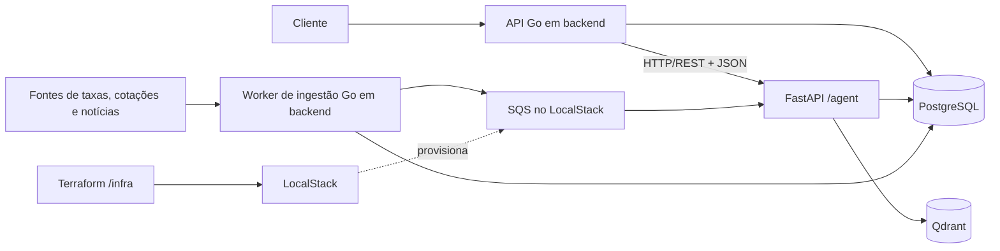

# Arquitetura

Este documento registra as decisões arquiteturais já definidas para o desafio e destaca os pontos que ainda precisam ser escolhidos durante a implementação. O escopo funcional está descrito em [CHALLENGE.md](./CHALLENGE.md), e as tarefas de implementação estão em [CHECKLIST.md](./CHECKLIST.md).

## Objetivo e escopo

Construir uma plataforma de ingestão de dados financeiros e notícias, processamento de notícias com embeddings e geração de rankings de ativos com justificativas baseadas em RAG.

O sistema não gerencia carteiras e não implementa autenticação de usuários. A API não deve aceitar operações ou dados cujo propósito seja criar ou atualizar carteiras.

## Componentes

| Componente | Responsabilidade |
| --- | --- |
| API Go (`/backend`) | Expor contratos HTTP com a biblioteca padrão `net/http`, receber pedidos de ranking, consultar dados e coordenar o processamento. |
| Worker de ingestão Go (`/backend`) | Coletar taxas, cotações e notícias; validar e persistir os dados; publicar notícias novas no SQS. |
| Motor de agentes Python (`/agent`) | Expor endpoints HTTP/REST com FastAPI, consumir mensagens de notícias, gerar embeddings e executar o fluxo RAG LangGraph para rankings justificados. |
| PostgreSQL 18 | Armazenar ativos, cotações, notícias, estado de idempotência e relatórios auditáveis. |
| Qdrant | Armazenar embeddings de notícias com metadados que permitam filtragem por ativo, data e sentimento. |
| Amazon SQS | Desacoplar ingestão e processamento de notícias, usando filas provisionadas localmente pelo LocalStack executado via Docker. |
| Infraestrutura (`/infra`) | Manter a configuração Terraform em `/infra/terraform` e os manifests Kubernetes nativos em `/infra/k8s`. |

## Diagrama de alto nível



O backend Go chama o motor Python de forma síncrona por HTTP/REST com payloads JSON. SQS é usado separadamente para o pipeline assíncrono de ingestão e processamento de notícias.

## Fluxos principais

### Ingestão de notícias

1. O worker Go coleta notícias e calcula o SHA-256 do conteúdo.
2. A notícia é persistida no PostgreSQL com uma chave ou constraint que permita deduplicação.
3. Somente notícias novas são publicadas na fila SQS `news-processing-queue`.
4. O consumidor Python processa a mensagem, gera o embedding e grava o ponto no Qdrant com `asset_ticker`, `published_at` e `sentiment_score`.
5. O consumidor confirma a mensagem depois de concluir o processamento. Falhas são reprocessadas e, após o limite configurado, encaminhadas à dead-letter queue (DLQ).

SQS oferece entrega *at-least-once*. Portanto, consumidores devem ser idempotentes e tolerar a entrega repetida da mesma mensagem. O tempo de visibilidade, a política de retries e o limite de recebimentos devem ser configurados junto da DLQ.

O produtor publica `title`, `content`, `contentHash`, `source`, `url` e
`publishedAt`. Se não receber `assetTickers`, o agente identifica códigos B3
explícitos no texto; se não receber `sentimentScore`, usa um léxico local
determinístico, limitado a `[-1, 1]`, e `0` quando nenhum termo for
reconhecido. Mensagens sem ticker são rejeitadas e permanecem na fila para
retry/DLQ. O ID de cada ponto Qdrant é determinístico a partir do hash do
conteúdo e do ticker; notícias associadas a tickers diferentes geram pontos
distintos.

### Geração de ranking

1. O cliente envia um pedido a `POST /recommendations/generate`, com `Idempotency-Key`.
2. A API Go registra ou recupera o estado do pedido e obtém os dados de mercado necessários.
3. O Go calcula deterministicamente taxas e indicadores financeiros e monta os dados de contexto.
4. O backend Go envia o contexto calculado via `POST /internal/agent/run`; o motor Python executa um grafo LangGraph linear com três etapas: busca de notícias relevantes no Qdrant, análise de risco/bandeiras vermelhas pelo LLM e formatação da resposta em JSON/Markdown.
5. O LLM produz a análise e a justificativa grounded nos dados calculados pelo Go e nas notícias recuperadas; não calcula valores financeiros.
6. O resultado, as cotações utilizadas e os IDs das notícias citadas são persistidos para auditoria.

A comunicação síncrona entre a API Go e o motor Python usa HTTP/REST com JSON: o backend implementa o cliente com a biblioteca padrão `net/http`, e o motor Python expõe os endpoints com FastAPI. A rota de execução é `POST /internal/agent/run`; os contratos JSON, erros e timeouts são definidos abaixo. Essa comunicação entre serviços não implica autenticação de usuários.

#### Request: `POST /internal/agent/run`

O Go envia o contexto financeiro já calculado deterministicamente. Valores decimais são strings para evitar perda de precisão na serialização JSON.

```json
{
  "reportId": "0192f298-345e-7e38-af88-e43f851a819d",
  "deterministicContext": {
    "fixedIncomeRates": [
      {
        "ticker": "TESOURO_IPCA_2029",
        "netRate": "0.0650"
      }
    ],
    "stocksAndFiis": [
      {
        "ticker": "VALE3",
        "type": "STOCK",
        "referencePrice": "68.50"
      }
    ]
  },
  "assetTypes": ["FIXED_INCOME", "STOCK", "FII"]
}
```

O endpoint recebe `Content-Type: application/json`.

#### Response de sucesso

Em caso de conclusão, retornar HTTP `200 OK` e `Content-Type: application/json`:

```json
{
  "status": "COMPLETED",
  "rankedAssets": [
    { "rank": 1, "ticker": "TESOURO_IPCA_2029", "type": "FIXED_INCOME" },
    { "rank": 2, "ticker": "VALE3", "type": "STOCK" },
    { "rank": 3, "ticker": "HGLG11", "type": "FII" }
  ],
  "justificationText": "O ranking priorizou Renda Fixa...",
  "citedNewsIds": ["qdrant-uuid-1", "qdrant-uuid-2"]
}
```

`citedNewsIds` contém os IDs exatos das notícias Qdrant usadas pelo agente e deve ser persistido como `sourceNewsIDs` no relatório de auditoria.

#### Erros e status HTTP

Erros usam um envelope JSON padronizado, simplificado a partir de RFC 7807 Problem Details:

```json
{
  "error": {
    "code": "LLM_PROVIDER_RATE_LIMIT",
    "message": "A cota do provedor de LLM foi excedida e nenhuma rota de contingência está disponível.",
    "retryable": true
  }
}
```

| HTTP status | Uso | Tratamento no Go |
| --- | --- | --- |
| `400 Bad Request` | JSON malformado ou campos obrigatórios ausentes no request do Go. | Tratar como erro de contrato; não repetir sem corrigir o request. |
| `422 Unprocessable Entity` | Falha de validação dos dados processados pelas tools do agente. | Registrar a falha de validação e não repetir automaticamente o mesmo payload. |
| `429 Too Many Requests` | Cota do provedor de IA esgotada. O agente tenta primeiro as rotas de contingência configuradas no OpenRouter; retornar esse status ao Go quando não houver rota disponível. | Aplicar retry/backoff ou deixar o relatório pendente para reprocessamento, conforme `retryable` e a política de idempotência. |
| `502 Bad Gateway` | Falha temporária ao acessar o Qdrant ou outra dependência upstream. | Considerar temporário e permitir reprocessamento controlado. |
| `503 Service Unavailable` | Serviço Python ou dependência necessária indisponível temporariamente. | Marcar a execução como pendente ou falha recuperável para reprocessamento. |

O Go deve também tratar timeout e erros de transporte como falhas potencialmente transitórias. Para evitar execução duplicada quando a resposta se perde depois de o agente iniciar ou concluir, usar o mesmo `reportId` para correlacionar e retomar a execução; não gerar um novo identificador em retries do mesmo pedido.

O FastAPI deve mapear explicitamente erros de parsing do request e campos obrigatórios ausentes para HTTP `400`, em vez de usar a resposta padrão `422` do framework. O status `422` fica reservado para erros de validação nos dados processados pelas tools do agente.

#### Timeouts

- **Dial timeout:** 3 segundos para estabelecer a conexão com o serviço Python.
- **Timeout total do cliente HTTP Go:** entre 30 e 45 segundos para cobrir a busca no Qdrant e a inferência do LLM sem deixar chamadas bloqueadas indefinidamente.
- Ao atingir o timeout, cancelar a requisição usando o contexto do Go, liberar recursos e atualizar o estado do relatório para pendente ou falha recuperável conforme a política de retry. O processamento Python deve usar o `reportId` e o checkpointer LangGraph para permitir retomada idempotente.

O cliente Go usa timeout total de **40 segundos**. O registro de idempotência e o
relatório `PROCESSING` são persistidos antes da chamada Python. A execução
bloqueia o registro de idempotência enquanto chama o agente, impedindo chamadas
concorrentes para a mesma chave; falhas de transporte, timeout e erros
retryable deixam o mesmo relatório pendente para retomada com a mesma chave e
`reportId`. A gravação do relatório concluído, das referências de cotações e
notícias, e da resposta idempotente ocorre em uma transação PostgreSQL.

### Contrato público da API Go

`POST /recommendations/generate` recebe `{"assetTypes":[...]}` e exige
`Idempotency-Key`. Uma repetição concluída com a mesma chave e o mesmo payload
reproduz a resposta original; reutilizar a chave com outro payload retorna
`409 Conflict`. Erros são retornados no envelope padronizado. Se ainda não há
resultado ou ocorreu falha retryable, a API retorna `503 Service Unavailable`
com `retryable: true`; o cliente deve repetir usando a mesma chave. Não há
endpoint de consulta de relatório nesta etapa. A liveness não consulta
dependências; a readiness verifica PostgreSQL, `GET <QDRANT_URL>/healthz` e
`GET <LOCALSTACK_URL>/_localstack/health`, exigindo estado SQS `available` ou
`running`.

O schema atual não armazena taxas brutas e prazos de renda fixa nem indicadores
fundamentalistas de ações/FIIs. Assim, nesta etapa o backend encaminha preços
de referência exatos das cotações mais recentes disponíveis para ações/FIIs,
sem inferir rentabilidade nem usar preço isolado como métrica de ranking.
`fixedIncomeRates` permanece vazio até existir uma fonte explícita de taxa e
prazo; ativos sem os dados necessários não são inventados nem classificados.
O contexto financeiro é ordenado deterministicamente por ticker e a resposta
do agente só pode classificar ativos presentes nesse contexto, com ranks
contíguos e IDs de notícias auditáveis.

### Orquestração do agente e estado

LangGraph foi escolhido para tornar explícita e controlada a sequência das etapas do agente:

1. **Busca (Passo 2):** consultar o Qdrant com os ativos e dados determinísticos recebidos do Go e recuperar notícias relevantes.
2. **Análise de risco (Passo 3):** usar o LLM para identificar bandeiras vermelhas nas notícias recuperadas, sem recalcular métricas ou valores financeiros.
3. **Formatação (Passo 4):** montar o JSON/Markdown final, incluindo a justificativa e os IDs exatos das notícias utilizadas (`sourceNewsIDs`).

O estado do grafo deve carregar o contexto financeiro calculado pelo Go, os ativos avaliados, os resultados da busca, os IDs das notícias, a análise de risco e a saída formatada. Um checkpointer LangGraph conectado ao PostgreSQL persistirá o estado da execução para possibilitar retomada após falhas ou reinícios do processo Python. O esquema e o ciclo de vida dos checkpoints devem ser integrados à estratégia de persistência e migrations do projeto.

## Persistência e precisão

- PostgreSQL é a fonte de verdade para cotações, notícias, estado de processamento e relatórios.
- O acesso Go ao PostgreSQL usa `sqlc` obrigatoriamente para gerar código tipado a partir de queries SQL.
- Migrations versionadas definem tabelas, constraints e índices.
- Constraints do banco são parte da garantia de deduplicação e idempotência, não apenas validações em memória.
- Cálculos e dados monetários não usam `float32` ou `float64`.
- Relatórios guardam os identificadores exatos das cotações no PostgreSQL e das notícias no Qdrant que sustentam a recomendação.
- Qdrant guarda os embeddings e seus metadados estruturados; o banco relacional preserva os dados necessários à auditoria do pipeline.
- `Money` representa unidades mínimas em `int64`, valida códigos ISO 4217 e expõe JSON com `amount` string e `currency`.
- A migration `000001_persistence_domain` define ativos, cotações, notícias, relatórios, vínculos de auditoria e registros de idempotência; cada migration tem arquivo de subida e reversão.
- `sqlc` gera o acesso tipado em `backend/internal/store` a partir de `backend/db/schema.sql` e `backend/db/query.sql`. O schema SQL e a migration inicial devem permanecer equivalentes.
- O worker seleciona notícias pendentes com `FOR UPDATE SKIP LOCKED` dentro de uma transação. A execução de recomendação deve bloquear o registro de idempotência com `FOR UPDATE` e gravar relatório, vínculos de auditoria e resposta idempotente na mesma transação.

## Decisões registradas

| Área | Decisão |
| --- | --- |
| Backend e ingestão | Go, com Uber Fx para injeção de dependência. |
| Estrutura do monorepo | `/backend` para o backend Go, `/agent` para o motor de agentes Python e `/infra` para infraestrutura, com `/infra/terraform` e `/infra/k8s`. O README da raiz apresenta o monorepo e cada serviço mantém seu README com instruções específicas. |
| Arquivos ignorados pelo Git | Um único `.gitignore` na raiz do monorepo reúne artefatos gerados pelos serviços, arquivos locais de ambiente e arquivos do sistema operacional. |
| Projeto Python | Python 3.11+ em `/agent`; `pyproject.toml` define metadados, dependências e configuração. Usar `uv` para gerenciamento e instalação de dependências, manter `uv.lock` versionado e usar `setuptools` como backend de build. Não usar `requirements.txt` como manifesto do projeto. |
| Orquestração de agentes | LangGraph, com fluxo linear explícito de busca no Qdrant, análise de risco com LLM e formatação JSON/Markdown; `AsyncPostgresSaver` persiste o estado, correlacionado pelo `reportId`. |
| Embeddings | Gemini `gemini-embedding-001`, com dimensão vetorial configurável e padrão de 768. A coleção Qdrant precisa usar a mesma dimensão. |
| LLM e fallback | OpenRouter. `OPENROUTER_MODELS` lista em ordem a rota primária (priorizar o tier gratuito) e pelo menos uma contingência. |
| Persistência relacional | PostgreSQL 18; acesso Go gerado obrigatoriamente com `sqlc`. |
| Domínio monetário e migrations | `Money` usa centavos inteiros exatos; migrations SQL numeradas têm arquivos `.up.sql` e `.down.sql`; o `sqlc` gera em `backend/internal/store`. |
| Busca vetorial | Qdrant, usando o SDK oficial `qdrant-client` no Python. |
| API HTTP | Biblioteca padrão Go `net/http`. |
| Comunicação síncrona Go–Python | HTTP/REST com JSON; cliente Go com `net/http` e serviço Python com FastAPI. |
| Contrato de execução do agente | `POST /internal/agent/run`; request contém `reportId`, `deterministicContext` e `assetTypes`; response contém status, ativos ranqueados, justificativa e IDs das notícias citadas. |
| Erros e timeouts Go–Python | Envelope JSON padronizado com `code`, `message` e `retryable`; status HTTP `400`, `422`, `429`, `502` e `503`; dial timeout de 3 s e timeout total de 40 s. |
| Pedido ainda em processamento | Responder `503` retryable e orientar repetição com a mesma `Idempotency-Key`; retomar o mesmo `reportId`, sem endpoint de consulta nesta etapa. |
| Readiness Go | Verificar PostgreSQL, `GET /healthz` do Qdrant e estado SQS do endpoint de saúde do LocalStack. |
| Mensageria | Amazon SQS, simulado localmente pelo LocalStack executado via Docker. Não usar RabbitMQ. |
| Orquestração de containers | Kubernetes local do Docker Desktop, com manifests nativos em `/infra/k8s`; não usar Helm ou Kustomize. O objetivo é aprendizado local, sem implantação em produção ou múltiplos ambientes. |
| Infraestrutura local | Configuração Terraform em `/infra/terraform`, manifests Kubernetes em `/infra/k8s`, Docker Compose e LocalStack para execução local. O Docker Desktop fornece o cluster Kubernetes local. |
| Carteiras e autenticação de usuários | Fora do escopo. |

`uv` foi escolhido pela velocidade de instalação, especialmente durante a construção das imagens Docker, e pelo lockfile `uv.lock`, que fixa as versões resolvidas para builds reproduzíveis. `setuptools` será usado como backend de build por sua maturidade e ampla compatibilidade com ferramentas de desenvolvimento e CI/CD.

### Provedores de IA

- **Embeddings:** usar `gemini-embedding-001` com 768 dimensões por padrão. `GEMINI_EMBEDDING_MODEL` e `GEMINI_EMBEDDING_DIMENSIONS` são configuráveis por ambiente; a inicialização falha explicitamente se a coleção `market-news` tiver dimensão incompatível. O consumidor grava índices de payload para `asset_ticker`, `published_at` e `sentiment_score`.
- **LLM:** OpenRouter será usado para análise de risco e geração de justificativas, priorizando modelos acessíveis pelo tier gratuito.
- **Rotas de contingência:** `OPENROUTER_MODELS` contém a rota primária e as contingências, separadas por vírgula e na ordem de tentativa. Configure a rota gratuita primeiro quando disponível. Rate limit, timeout, indisponibilidade e saída inválida acionam a próxima rota; se todas as rotas retornarem limite, responder `429`, e se falharem por outras causas, `503`.
- **Configuração:** credenciais, identificadores de modelos e parâmetros das rotas devem ser configuráveis por ambiente, sem segredos no código.
- **Checkpointer:** usar `AsyncPostgresSaver` e executar `setup()` na inicialização; o mesmo `reportId` é enviado como `thread_id` em toda tentativa, para recuperar o checkpoint após falhas.

## Decisões pendentes

As escolhas abaixo ainda não estão determinadas pelos requisitos e devem ser registradas aqui quando forem tomadas:

- Fontes concretas de cotações e respectivas regras de atualização.
- Tipo de fila SQS, valores de visibility timeout, política de retries e quantidade máxima de recebimentos antes da DLQ.
- Recursos AWS simulados que serão provisionados além do SQS.
- Fonte, escala, prazo e regra tributária necessários para calcular taxas líquidas de renda fixa.
- Métricas fundamentais e fórmula determinística de ranking para ações e FIIs.

## Execução local e infraestrutura

- Docker Compose mantém PostgreSQL e Qdrant locais em volumes nomeados
  (`postgres-data` e `qdrant-data`) para preservar o estado após reinícios dos
  containers. O endpoint Qdrant local é `http://localhost:6333`.
- LocalStack simula SQS no ambiente local.
- Terraform em `/infra/terraform` provisiona os recursos AWS simulados pelo LocalStack, incluindo filas SQS e DLQ.
- Kubernetes usa manifests nativos mantidos em `/infra/k8s` para API, worker e motor Python, além das dependências aplicáveis. A escolha de manifests diretos prioriza o aprendizado dos recursos básicos do Kubernetes; o ambiente é local e não será promovido entre ambientes nem para produção.
- O cluster Kubernetes local é fornecido pelo Docker Desktop; habilite Kubernetes nas configurações do Docker Desktop e use o contexto `docker-desktop` do `kubectl`.
- Configuração e segredos são fornecidos por ambiente e mecanismos próprios de configuração, nunca embutidos no código.
- Liveness verifica se o processo está ativo; readiness verifica dependências necessárias para atender tráfego, incluindo PostgreSQL, Qdrant e SQS.

## Testes e garantias operacionais

- Testes de integração usam PostgreSQL, Qdrant e SQS no LocalStack.
- Testes concorrentes comprovam deduplicação da ingestão e idempotência de pedidos com a mesma `Idempotency-Key`.
- Testes de falha verificam retries, DLQ e recuperação após reinícios ou indisponibilidade temporária de dependências.
- Os comandos obrigatórios do desafio incluem `go test -race ./...` e `pytest`.
